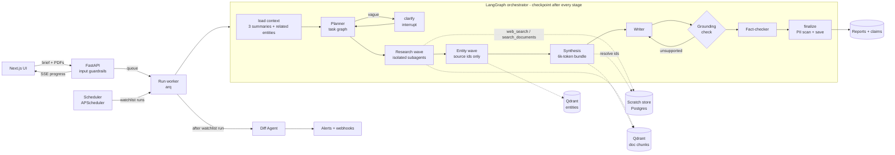

# InsightForge AI — autonomous market-intelligence engine

Give it a research brief ("Competitive landscape for B2B payroll software in Southeast Asia…"), optionally a few
PDFs, and a few minutes later you get a structured, cited report: every claim traces to a source paragraph, a
sample of claims is re-checked against freshly fetched sources, and what the research could not resolve is listed
plainly. Topics can be put on a watchlist and re-researched on a schedule, with alerts only when findings change.

- **Multi-agent pipeline:** a DeepAgents Planner spawns isolated researchers through the `task` tool, orchestrated
  by a LangGraph state graph with typed state at every boundary.
- **Context engineering:** raw content lives in a keyed scratch store and Qdrant; agents get references and pull
  text on demand. On the evaluation run a 121k-token corpus reached the Planner as 1.2k tokens and the Writer as a
  2.5k-token evidence bundle (budget 6k).
- **Guardrails and reliability:** input, output, untrusted-content and webhook guardrails; hard time and token
  budgets; grounding check with retries; fact-checking; checkpoints at every stage and every agent, so a failure
  resumes where it stopped instead of starting over.

**Evaluation (1 live run, `ev-charging-eu`):** fact-check 6/7 (86%), citation accuracy 37/37 (100%), synthesis
quality 3.8/5, must-cover topics 100%, 217k tokens, 218 s. Details in [eval/report.md](eval/report.md); the report
itself is in [docs/sample-report.md](docs/sample-report.md) ([PDF export](docs/sample-report.pdf)). A second
sample, Bolt.Earth vs its competitors in India's EV charging market, run through the UI:
[Markdown](docs/sample-report-bolt-earth.md) · [PDF](docs/sample-report-bolt-earth.pdf).

---

## Contents

1. [Architecture](#architecture)
2. [Setup](#setup)
3. [Required API keys](#required-api-keys)
4. [Environment variables](#environment-variables)
5. [Walkthrough: one brief, input to exported PDF](#walkthrough-one-brief-input-to-exported-pdf)
6. [Context engineering](#context-engineering)
7. [Multi-agent design](#multi-agent-design)
8. [Guardrails, budgets and recovery](#guardrails-budgets-and-recovery)
9. [Watchlist and change detection](#watchlist-and-change-detection)
10. [Evaluation](#evaluation)
11. [Bonus features](#bonus-features)
12. [Testing](#testing)
13. [Project layout](#project-layout)
14. [Known limitations](#known-limitations)

---

## Architecture

The full diagram, with numbered components, layers and trust boundaries, is in
[docs/architecture.html](docs/architecture.html) (open it in a browser). The run pipeline:



| Layer | What runs there |
|---|---|
| Online path | Next.js → FastAPI (JWT, per-user scoping, rate limits, input guardrails) → queue; SSE carries progress only; the report is fetched after it passes grounding and fact-checking |
| Controlled execution | LangGraph graph, Planner deep agent, researcher subagents, Synthesis, Writer, grounding check, Fact-Checker, model gateway (OpenRouter, budgets, fallback) |
| State | Postgres (runs, sub-tasks, run log, scratch store, reports, claims, checkpoints, watchlist, alerts), Qdrant (doc chunks, entities, session summaries, temporary fact-check collections), Redis (queue, rate limits) |
| Operations | Run worker and scheduler as separate processes, per-stage token and time logging, automatic resume of retryable failures, evaluation runner |

---

## Setup

Prerequisites: Docker, [uv](https://docs.astral.sh/uv/) (Python 3.12 is installed by uv), Node.js 20+.

```bash
cp .env.example .env
# fill in OPENROUTER_API_KEY and TAVILY_API_KEY (see "Required API keys")
# set both signing secrets (at least 32 random characters each):
openssl rand -base64 48   # → JWT_SECRET
openssl rand -base64 48   # → WEBHOOK_SIGNING_SECRET
```

### Local development (recommended)

```bash
docker compose up -d                              # Postgres, Redis, Qdrant

cd backend
uv sync                                           # Python deps (Docling pulls in PyTorch: large first install)
uv run alembic upgrade head                       # database schema
uv run uvicorn insightforge.main:app --reload     # API on :8000 (docs at /docs, health at /health)
uv run arq insightforge.worker.WorkerSettings     # run worker (second terminal)
uv run insightforge-scheduler                     # watchlist scheduler (third terminal, optional)

cd ../frontend
npm install
npm run dev                                       # UI on http://localhost:3000
```

Sign in with any email on the dev sign-in screen (`ALLOW_DEV_LOGIN=true`; production would use an identity
provider).

### CLI (no UI)

```bash
cd backend
uv run insightforge "Competitive landscape for B2B payroll software in Southeast Asia"
uv run insightforge "Summarise pricing in these reports" --pdf a.pdf --pdf b.pdf
uv run insightforge --resume <run-id>             # continue a failed run from its last checkpoint
```

### Everything in Docker

```bash
docker compose --profile app up -d --build        # infra + API + worker + scheduler + UI
```

The API container applies migrations before starting; the UI is on http://localhost:3000 and the API on :8000.
The backend image (~5.4 GB, mostly Docling's CPU-only PyTorch) includes the system libraries for PDF export (pango)
and Docling. Verified: all services start, the API is healthy, PDF export works in the container.

**PDF export locally:** WeasyPrint needs pango (`brew install pango` on macOS; the exporter adds Homebrew's
lib directory to the library search path itself, so no shell setup is needed). Without pango,
`/export?format=pdf` returns 501 with that hint; Markdown export always works.

---

## Required API keys

| Key | Required | What for |
|---|---|---|
| `OPENROUTER_API_KEY` | yes | All LLM calls go through [OpenRouter](https://openrouter.ai) via the model gateway |
| `TAVILY_API_KEY` | yes (default provider) | Web search. Or set `SEARCH_PROVIDER=brave` + `BRAVE_API_KEY`, or `SEARCH_PROVIDER=serpapi` + `SERPAPI_API_KEY` |
| `JWT_SECRET` | yes (API) | Signs login tokens and share links; the API refuses to start without ≥ 32 characters |
| `WEBHOOK_SIGNING_SECRET` | yes (webhooks) | HMAC signature on outgoing webhook payloads |
| `LANGSMITH_API_KEY` | optional | Tracing (bonus): with `LANGSMITH_TRACING=true` and `LANGSMITH_PROJECT=insightforge`, LangChain/LangGraph send traces of agent, model and tool calls automatically (not exercised in this project's runs) |

Embeddings run locally (FastEmbed `BAAI/bge-small-en-v1.5`): no key needed.

---

## Environment variables

All settings live in `backend/src/insightforge/config.py`; any of them can be set in `.env` (upper-case name).

| Variable | Default | Meaning |
|---|---|---|
| `DATABASE_URL` / `REDIS_URL` / `QDRANT_URL` | local Docker services | Infrastructure |
| `MODEL_PRIMARY` / `MODEL_SECONDARY` | `anthropic/claude-sonnet-5.5` / `anthropic/claude-haiku-5.5` | Judgment roles use primary, high-volume roles secondary; each falls back to the other. A verified cheap pair is documented in `.env.example` (`deepseek/deepseek-v4.1-flash` / `z-ai/glm-5.3-flash`) |
| `AGENT_OUTPUT_STRATEGY` | `auto` | How agents with tools return typed results: native JSON schema for Claude, forced tool call for open models |
| `SEARCH_PROVIDER` | `tavily` | `tavily`, `brave` or `serpapi` |
| `MAX_SUBTASKS` | 6 | Planner cap (can only be lowered) |
| `RUN_TIME_BUDGET_S` | 480 | Per-attempt time budget |
| `RUN_TOKEN_BUDGET` | 300000 | Per-attempt token budget (measured: a clean run ≈ 185–230k) |
| `EVIDENCE_BUNDLE_TOKEN_BUDGET` | 6000 | What the Writer may receive |
| `ADAPTIVE_BUNDLE_BUDGET` | false | Bonus: scale that budget with sub-task count and source volume (4k–9k; a typical brief keeps 6k) |
| `MAX_WRITER_RETRIES` | 2 | Rewrites after a failed grounding check (skipped if time or tokens can't cover one) |
| `MAX_AUTO_RESUMES` / `MAX_RUN_ATTEMPTS` | 1 / 3 | Automatic resume of retryable failures; total attempts incl. manual retries |
| `FACTCHECK_SAMPLE_RATIO` / `FACTCHECK_MIN_CLAIMS` / `FACTCHECK_SIMILARITY_THRESHOLD` | 0.20 / 5 / 0.85 | Fact-check sampling and pass threshold |
| `ENTITY_MAX_SOURCES` / `ENTITY_SOURCE_MAX_CHARS` | 20 / 5000 | Bounds on the entity wave |
| `MAX_PDFS_PER_RUN` / `MAX_PDF_MB` / `DOCLING_OCR` | 10 / 20 / false | Upload limits; OCR is off (text PDFs only) |
| `RUNS_PER_HOUR_PER_USER` / `MAX_ACTIVE_RUNS_PER_USER` | 10 / 2 | API rate limits |
| `CLARIFICATION_TIMEOUT_S` | 1800 | Unanswered clarifying questions cancel the run |
| `WATCHLIST_INTERVAL_OVERRIDE_S` | unset | Demo/testing: run every watched topic every N seconds |
| `ALLOW_DEV_LOGIN` / `APP_BASE_URL` | true / `http://localhost:3000` | Dev sign-in; frontend origin (CORS, share links) |
| `NEXT_PUBLIC_API_URL` (frontend) | `http://localhost:8000` | Where the browser calls the API (`frontend/.env.local.example`) |

---

## Walkthrough: one brief, input to exported PDF

This follows the evaluation run (`ev-charging-eu`, run `ca38f566…`). Numbers are from its run log.

1. **Brief.** On *New brief*, enter "European EV fast-charging networks: the largest operators by number of
   high-power chargers, typical pricing per kWh, and expansion plans announced in the last 12 months." The counter
   shows 169/500; the estimate is ~3 minutes. *Run research*.
2. **Input guardrails.** The API cleans the text, rejects instruction-like briefs, checks source toggles and PDFs,
   and asks a small model whether this is a market-research brief. It queues the run and returns 202.
3. **Planning.** The worker loads the last 3 session summaries and related past entities, and the Planner writes a
   typed task graph: 4 sub-tasks (operators, pricing, expansions, policy), each with query, scope, time horizon and
   priority. A vague brief would get one clarifying question instead, answered inline in the UI.
4. **Research wave.** The Planner delegates each sub-task id through the `task` tool; middleware replaces it with a
   fixed prompt built from the typed spec, so a researcher never sees the brief or sibling output. Each researcher
   searches, fetches full article bodies (paywalls skipped), stores them in the scratch store and returns only
   source ids with one-line summaries. The progress view shows each sub-task go Queued → Running → Done.
5. **Entity wave.** One extractor subagent receives only the 15 kept source ids, extracts entities and facts a few
   sources per call, and code flags conflicting facts (e.g. Allego's charger count from two sources).
6. **Synthesis.** Resolves the ids, picks the most relevant paragraphs per source, extracts claims, drops two
   sources outside their sub-task's time horizon (noted for the Writer), de-duplicates, scores confidence and
   ranks: 39 evidence items, 2,518 tokens.
7. **Writing and grounding.** The Writer returns sentences tagged with evidence ids; code renders the Markdown,
   citations and confidence labels. The grounding check (ids exist, numbers appear in the cited evidence, then an
   entailment check) sent two drafts back with explicit constraints; the third passed.
8. **Fact-check.** 7 claims (max(20%, 5)) were re-checked against freshly fetched sources; 6 passed, 1 is marked
   `[UNVERIFIED]` in amber. The report is saved; the progress view shows *Open report*.
9. **Report.** Sticky contents, confidence badges per section, clickable citations (title, date, credibility and the
   exact source paragraph in a side drawer), the fact-check summary, and Gaps & Limitations.
10. **Export.** *Download PDF* (or *Download .md*), or *Copy share link* for a read-only link that expires in 7 days.

---

## Context engineering

Nothing raw sits in an agent's prompt unless that agent's job needs it:

| Mechanism | Where |
|---|---|
| Keyed scratch store for every fetched page; PDF chunks and entities in Qdrant; `read_source(id)` pages content on demand | `store/scratch.py`, `store/sources.py`, `tools/read_source.py` |
| Researchers return `{source_id, one-line summary}` only; invented ids are dropped against storage | `agents/delegation.py` |
| Isolation in code: the Planner delegates by id, middleware swaps in a fixed prompt from the typed spec; wrong subagent types and the auto-added general-purpose agent are refused | `agents/delegation.py` |
| The Entity Extractor receives source ids only and reads each source in its own call batch | `agents/entity_extractor.py` |
| Synthesis is the only agent that reads raw text, and only the 3 most relevant paragraphs per source (keyword shortlist, then embeddings) | `agents/synthesis.py` |
| Evidence bundle ≤ 6,000 tokens; over budget, the lowest-ranked items are summarised (never truncated), each cut logged with its reason | `agents/synthesis.py` (`_compress`) |
| The Writer sees the rendered bundle (claims + metadata), never source pages; the grounding judge sees only the evidence each claim cites | `agents/writer.py`, `guardrails/grounding.py` |
| Memory: the Planner loads the last 3 compressed session summaries, never transcripts; DeepAgents' summarisation middleware compacts long agent conversations | `store/memory.py` |

**A blowout this prevented (from the run logs).** On run 15 (payroll brief, Claude) the researchers stored
**202,171 tokens** of article text in the scratch store. Passed through naively (brief + every fetched page into
the Planner, then into the Writer), that is more than a 200k-token context window before any instructions or
output, and every later call would have re-sent it. Instead the Planner received **1,561 tokens** of references
(about 1/130 of the corpus) and the Writer a **3,666-token** evidence bundle against a 6,000-token budget. The
evaluation run shows the same shape: 121,382 → 1,230 → 2,518 tokens. Per-stage token use is logged for every run
(`orchestrator/tokens` events), which is how these numbers were measured.

---

## Multi-agent design

- **Planner** (`agents/planner.py`): first a structured call that returns a typed `TaskGraph` (≤ 6 sub-tasks,
  or one clarifying question), saved to Postgres for the progress view; then a `create_deep_agent()` root with
  `write_todos` that delegates every sub-task in parallel through `task`.
- **Researchers** (`agents/web_search.py`, `agents/doc_reader.py`): isolated subagents with one tool each, read-only
  file access, a tool-call limit, a fallback model and a typed `ResearchResult`.
- **Delegation ledgers** (`agents/delegation.py`): one middleware enforces isolation for both waves; a ledger per
  wave owns the assignment ids, renders the fixed prompts and validates results.
- **Typed state everywhere** (`graph/state.py`): `TaskGraph`, `ResearchResult`, `EntityGraph`, `EvidenceBundle`,
  `WriterOutput`/`Draft`, `GroundingResult`, `FactCheckSummary` and the LangGraph `PipelineState`.
- **Models** (`llm/gateway.py`): role → model tier, per-role output and time limits, bounded reasoning effort for
  narrow roles, fallback to the other tier, and a token meter that enforces the run budget before every call.

---

## Guardrails, budgets and recovery

| Concern | Control |
|---|---|
| Input (03a) | Length after cleaning, smuggling characters stripped, instruction-like text rejected, PDF magic/size/count, LLM scope and policy check that fails closed |
| Untrusted content (03c) | Pages, PDFs and tool output wrapped as data ("content, not instructions"), scripts and hidden text stripped, injection scan logged; researchers have no write tools; SSRF-guarded fetcher |
| Output (03b) | Grounding check with retries, then unsupported claims are dropped and listed under Gaps; fact-check with `[UNVERIFIED]`; PII redaction |
| Webhooks (03d) | HTTPS + public IPs only (checked at save and send), no redirects, HMAC-signed, retries with backoff, Slack format |
| Budgets | Time (480 s per attempt) and tokens (300k per attempt) enforced; rewrites skipped when either can't cover one; entity wave bounded |
| Recovery | LangGraph checkpoint after every stage (written synchronously); researcher results and entity extractions saved as agent-level checkpoints. A failed run resumes at the failed stage, re-running only unfinished agents: automatically once for retryable failures, or via *Retry* / `--resume`. Verified live: a run killed during writing resumed and re-ran only writing, grounding and fact-checking. Worker jobs act only on runs in the state they were queued for (a crashed worker's job is never re-run from scratch); runs orphaned by a dead process are marked failed after the run budget, ready to retry |
| Access | JWT per user, every query scoped by user id, share links scoped to one report and revocable |

---

## Watchlist and change detection

The scheduler (`watchlist/scheduler.py`) runs as its own process with a Postgres job store (`coalesce`,
`max_instances=1`, misfire grace) and reconciles jobs with the watchlist table every minute. Each firing queues a
normal run. After a watchlist run completes, the Diff Agent (`agents/diff.py`) compares its claims with the
previous report's:

- a near-identical sentence with different figures is a change (decided in code; embeddings can't tell "$7.6M"
  from "$9M");
- a change requires the same subject: two companies' funding rounds are never "a change";
- everything else goes to one batched judge call that classifies it as new, changed, removed or not material;
- the first report is the baseline; removals alone don't alert (research samples different sources each run).

Alerts appear in the dashboard's feed and, if configured, are POSTed to a webhook (Slack incoming webhooks get
Slack's format).

---

## Evaluation

```bash
cd backend
uv run insightforge-eval --brief ev-charging-eu   # run a sample brief live, then score it
uv run insightforge-eval --run-id <uuid>          # score a finished run (judge calls only)
uv run insightforge-eval --report                 # rebuild eval/report.md
```

The sample brief library (`briefs/briefs.json`) has 5 briefs across industries and question types, each with
expected sections and must-cover topics. Metrics: the run's own fact-check pass rate; citation accuracy (every
claim judged against the source paragraphs it cites, by the primary model, independent of the in-run grounding
check); synthesis quality (rubric judge, 1–5 on coverage, structure, faithfulness, gaps honesty and clarity, plus
deterministic structure and coverage checks); context-engineering and cost figures.

**Results so far (1 of 5 briefs run live, by choice to limit cost):**

| Brief | Fact-check | Citation accuracy | Quality | Must-cover | Tokens | Time |
|---|---|---|---|---|---|---|
| ev-charging-eu | 6/7 (86%) | 37/37 (100%) | 3.8/5 | 100% | 217,379 | 218 s |

The rubric judge's weakest scores were coverage (operator ranking by charger count went largely unanswered: the
sources didn't provide a comparable ranking, which the report says under Gaps) and faithfulness/clarity (some
single-source figures, dense pricing paragraphs). Rubric scores vary by about ±0.2 between judgings. Earlier
development runs on the payroll brief (not part of the formal evaluation) fact-checked at 75–100% after the
claim-sized-window fix; one run before that fix scored 50% (5/10).

The other four briefs are ready to run; their results are added to `eval/report.md` automatically.

---

## Bonus features

| Bonus | How it works | Where |
|---|---|---|
| Contradiction resolution UI | Opt-in per run ("Let me resolve conflicting facts…" or `--review-conflicts`). After Synthesis, each entity conflict with both sides in the evidence bundle pauses the run (`AWAITING_REVIEW`, same interrupt/resume as clarification). The run page shows the versions side by side with publishers and quotes; the chosen version is kept as analyst-confirmed, the others are dropped with a logged reason, "Keep both" leaves the disagreement for the Writer. Unanswered after 30 minutes, both versions are kept and the run continues | `agents/conflict_review.py`, review node in `graph/pipeline.py`, `POST /research/{id}/resolve`, `components/run-progress.tsx` |
| Entity graph visualizer | *Entity graph* tab on the report: force-directed layout of the 40 most connected companies, people and products; red ring = conflicting facts; clicking a node lists its facts with publishers and the report's evidence about it (each opens the citation drawer) | `components/entity-graph.tsx` |
| Source credibility tuning | *Source settings* on the brief form: blocked domains are never fetched; deprioritized domains are used with credibility halved, which lowers their rank and confidence | `tools/credibility.py`, `tools/web_search.py` |
| Citation trace | Click any cited sentence in the report to open the exact source paragraph it was drawn from | `components/report-viewer.tsx` |
| Adaptive context budgets | `ADAPTIVE_BUNDLE_BUDGET=true` scales the evidence budget with sub-task count and source volume | `agents/synthesis.py` (`adaptive_budget`) |
| LangSmith tracing | Set `LANGSMITH_TRACING=true` + key: LangChain/LangGraph trace every call (not exercised in this project's runs) | env only |

---

## Testing

```bash
cd backend
uv run pytest -q          # 183 tests; DB/Qdrant tests skip if docker compose isn't up (they use the dev database)
uv run ruff check src tests
cd ../frontend && npm run lint && npm run build
```

Tests cover isolation (researchers never see the brief or siblings' output), budget and compression behaviour,
grounding and fact-check rules, SSRF and webhook guards, checkpoint resume at stage and agent level, the API
(auth, guardrails, rate limits, SSE, share links), the scheduler and the Diff Agent, using deterministic fake
models. A live OpenRouter smoke test runs when a key is configured.

---

## Project layout

```
backend/src/insightforge/
  agents/        planner, delegation, web_search, doc_reader, entity_extractor, synthesis, conflict_review, writer,
                 fact_checker, diff
  api/           auth, research (+ SSE), reports (export, share), watchlist, users
  graph/         state.py (typed schemas), pipeline.py (LangGraph orchestrator, budgets, resume)
  guardrails/    input, untrusted, grounding, output, webhooks, net (SSRF)
  llm/           gateway (OpenRouter, budgets, fallback), embeddings, tokens, schema
  store/         models, db, scratch, sources, qdrant, memory, entity_store, reports, run_log
  tools/         search providers, fetch, credibility, web_search, doc_search, docling_ingest, entities, lexical
  watchlist/     service, scheduler
  runtime.py     shared run runtime (worker + CLI)    worker.py   arq worker
  cli.py         insightforge CLI                     evaluation.py   insightforge-eval
backend/migrations/   Alembic
frontend/src/         Next.js app (brief, run/[id], report/[id], share/[token], reports, watchlist)
briefs/               sample brief library
eval/                 results and report
docs/                 architecture.html, sample reports (.md + .pdf)
```

---

## Known limitations

- **Research variance between runs.** Two runs on the same topic read different sources, so watchlist diffs
  include findings that are new to the report rather than new in the world. Comparing additions against all
  earlier reports for a topic would reduce this.
- **Fact-check threshold vs paraphrase.** The 0.85 cosine threshold (as specified) occasionally flags true but
  heavily paraphrased claims; claim-sized windows reduced this (live runs since: 75–100%; 50% on one run before).
- **Webhooks** were tested with a local mock receiver, not a live Slack workspace.
- **OCR is off**, so scanned PDFs yield no text (reported as a skipped file).
- **Time horizons** exclude dated sources outside the window; undated sources are kept and rank last.
